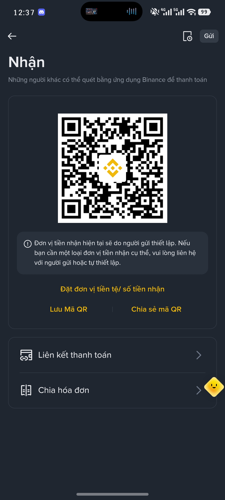

Thank you for visiting my blog and taking an interest in what I share. If you find my articles or projects useful, you can support me through one of the options below. Contributions are entirely voluntary.

## Bank transfer

- **MB Bank:** `1203086868`

## Digital wallets

- **MoMo:** [me.momo.vn/hzzmonet](https://me.momo.vn/hzzmonet)
- **Telegram Gifts:** [@hzzmonet](https://t.me/hzzmonet)

## Cryptocurrency

- **USDT — BNB Smart Chain (BEP20):** `0x2735de52aa5ff33c0141d7455a2c9c07d1896013`
- **USDT — TRON (TRC20):** `TKMGNBWC7oQMLLoiaBZ2MNJr2E7w8t13nR`
- **TON:** `UQC7jWaZiAam_C2kYpZIZeV6xdSh264VrdfE2gUlLD0_0yAG`

**Please note:** Check the network and address carefully before sending. Send USDT only on the corresponding BEP20 or TRC20 network. Funds sent on the wrong network may not be recoverable.

## Binance Pay

You can scan the Binance QR code below. In the Binance app, verify the asset and recipient details before confirming a payment.

